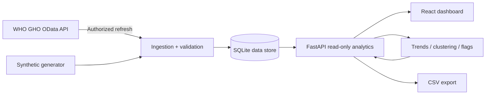
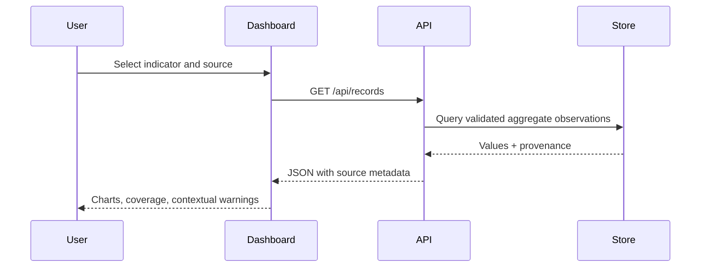

# System architecture

## Trust boundaries

- A secret admin token is mandatory for the opt-in external WHO refresh. Readers can query only aggregate records. No patient data is ingested.
- The HTTP client calls a hard-coded approved WHO host, limits pages and request timeout, and rejects other next-link hosts.
- SQLite enforces country/year/indicator/source uniqueness; validated fields and source provenance are stored with each observation.
- The demo and WHO datasets are never silently combined. UI selections and export filenames always declare the source.
- The default interface displays a clearly labeled deterministic example; it does not claim live measurements.
- Country-level averaging is explicitly unweighted. WHO regional estimates require different methodology.

## Data flow

