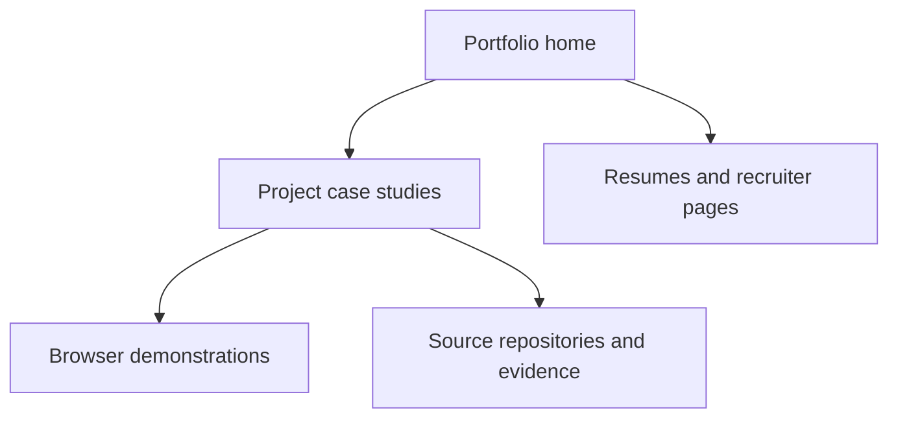

# Kavali Harshavardhan | AI, Data & Software Portfolio

Kavali Harshavardhan’s fresher portfolio: data analytics, Python, AI demonstrations, project evidence and role-specific resumes.

[Setup](#local-installation--setup-guide) · [Architecture](#architecture--system-design-diagram) · [Detailed guide](PROJECT_GUIDE.md) · [Repository standard](docs/REPOSITORY_STANDARD.md)

## Visuals

Explore the [published portfolio](https://harshakavali81-collab.github.io/harshavardhan-portfolio/) for the current visual design and interactive case studies. Project screenshots and illustrations are linked from their individual case studies.

## Live Link / Demo

Existing published preview link: [Open browser preview](https://harshakavali81-collab.github.io/harshavardhan-portfolio/). This update does not independently verify its availability or backend deployment.

## Key Features

- [Project case studies](cases/) connecting business questions, implementation and evidence.
- [Role-specific resumes](resumes.html) and [recruiter overview](recruiter.html).
- [Evidence map](proof-map.html) and [engineering walkthrough](engineering.html).
- Browser demonstrations of analytics, document AI and data-engineering projects.

## Tech Stack

  

Static HTML/CSS/JavaScript pages and assets, with supporting scripts and embedded project demonstrations.

## Architecture / System Design Diagram



## Local Installation & Setup Guide

```bash
git clone https://github.com/harshakavali81-collab/harshavardhan-portfolio.git
cd harshavardhan-portfolio
python -m http.server 8080 --bind 127.0.0.1
```

Open http://127.0.0.1:8080. Python is used only as a local static-file server. Existing GitHub Pages publishing settings are described in [Project guide](PROJECT_GUIDE.md).

## Challenges & Solutions

**Repository organization:** this project uses its existing project-specific entry points. Keeping those paths stable avoids breaking imports, asset links and deployment commands while the documentation follows a shared format. Project-specific technical limitations and prior release evidence are retained in [Project guide](PROJECT_GUIDE.md).

## Future Improvements

- Capture a reproducible end-to-end demo with runtime versions and sample inputs.
- Expand regression checks for invalid inputs and documented edge cases.
- Record measured results, data provenance and deployment limitations alongside each release.

## Scope and supporting evidence

This is a fresher’s project portfolio. Project demos, synthetic metrics and historical evidence are not claims of prior production engineering employment. Academic documents and third-party assets retain their respective rights.

## Repository Structure

| Location | Purpose |
| --- | --- |
| `docs/` | Documentation |
| `data/` | Data and samples |
| `assets/` | Visual assets |
| `scripts/` | Automation scripts |
| `cases/` | Portfolio case studies |
| `.github/` | Issue forms, PR template and automated checks |

[Complete file inventory and workflow](docs/REPOSITORY_STANDARD.md). Runtime entry points retain their existing paths.

## Workflow & Tracking

Use the [bug and feature forms](https://github.com/harshakavali81-collab/harshavardhan-portfolio/issues/new/choose) to define work with acceptance criteria. Keep tasks in Todo → In progress → Review → Done, and link a pull request with `Closes #<number>`. See [the maintenance workflow](docs/REPOSITORY_STANDARD.md#workflow).

## License

No root license file is present. Reuse rights need to be established before an open-source release; bundled papers, datasets and third-party assets may have separate terms.
