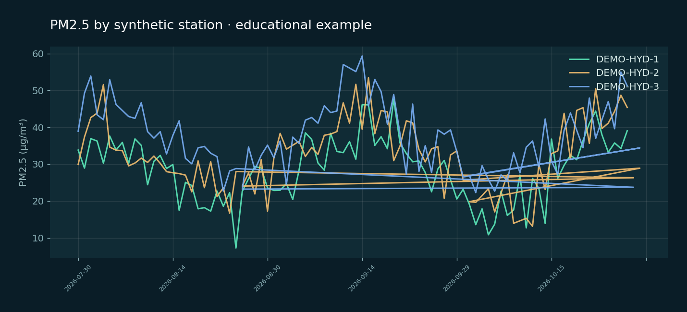

# 🌎 AirAware AI — Air Pollution & Heat Risk Intelligence

> **A source-aware environmental intelligence dashboard.** See PM2.5 daily measurements, weather conditions, station coverage, trends, a transparent baseline forecast and data quality, with demo/live modes that never silently mix.





  

**What works locally:** reproducible synthetic time-series data, read-only FastAPI routes, real-source OpenAQ v3 + Open-Meteo clients (credentials/network required), analytical processing, SQL snapshot support, station-map UI, forecasting baseline, offline Random Forest benchmark, tests, Compose configuration, Power BI CSV example and portfolio case study.

**Not claimed:** Live production deployment, a verified AQI calculation, independently validated forecasting skill, an official weather/health alert system, or results from the unrelated [OpenKit Air Aware case study](https://openkit.co.uk/portfolio/air-aware).

## Quick start — Python API

```bash
python -m venv .venv
# Windows: .venv\\Scripts\\activate  |  macOS/Linux: source .venv/bin/activate
python -m pip install -e '.[dev]'
cp .env.example .env  # on Windows: copy .env.example .env
uvicorn backend.app.main:app --reload
```

Visit `http://localhost:8000/docs` (Swagger) or `http://localhost:8000/api/overview?city=Hyderabad`.

## React dashboard

```bash
cd frontend
npm install
npm run dev
```

Open `http://localhost:5173`; Vite proxies `/api` to the Python API. Alternatively run `docker compose up --build` at the repository root and open `http://localhost:8080`.

For Windows, a `START_WINDOWS.ps1` helper runs installation and launches the local demo. PowerShell execution policies vary; review a script before running it.

## Optional live source mode

1. Obtain an OpenAQ API key at https://explore.openaq.org and set `OPENAQ_API_KEY=...` in `.env`.
2. Set `AIR_DATA_MODE=live` and restart the API. Only PM2.5 sensors with `µg/m³` units are accepted; other units are excluded. Available observations vary by city/time/sensor.
3. If OpenAQ is unavailable or your key is missing, the API responds with an error. **It never substitutes synthetic values without telling you.**
4. Weather uses Open-Meteo and is described as model-grid information; on error it is marked unavailable.

## API endpoints

| Route | Description |
|---|---|
| `GET /api/health` | API availability and active mode |
| `GET /api/cities` | Supported city centers |
| `GET /api/overview?city=Hyderabad` | PM2.5 stats, weather and freshness |
| `GET /api/trends?city=Hyderabad&days=30` | Daily history; 7–120 days |
| `GET /api/stations?city=Hyderabad` | Station metadata, last reporting day |
| `GET /api/forecast?city=Hyderabad&days=7` | **Untrained persistence baseline**, separate from observations |
| `GET /api/quality?city=Hyderabad` | Coverage, freshness and exploratory anomaly flags |

## ML evaluation and SQL export

```bash
python -m src.airaware.models.train --city Hyderabad --output data/processed/demo_model.joblib
python -m scripts.export_demo
# Optional: benchmark a properly licensed source CSV with date,station,pm25 columns
python -m src.airaware.models.train --csv data/processed/hyderabad_synthetic_pm25.csv --city Hyderabad --output data/processed/imported_demo_model.joblib
python -m pytest -q
```

An optional `--csv` input accepts validated station readings; CSV-only results are not automatically considered deployable. Training prints chronological 80/20 holdout MAE/RMSE for prior-day persistence versus Random Forest. These scores are from **fabricated educational data**, so never use them as proof of predictive performance in a real city. API forecasts intentionally remain an untrained baseline rather than silently deploying this model.

Import `data/processed/hyderabad_synthetic_pm25.csv` into Power BI using [`powerbi/README.md`](powerbi/README.md). An authored `.pbix` isn't included.

## Project tree

```text
AirAware-AI/
├── .github/workflows/ci.yml
├── backend/app/                 # FastAPI + read-only routes + SQLite snapshots
├── src/airaware/
│   ├── ingestion/               # OpenAQ, Open-Meteo, seeded demo, live parser
│   ├── processing/              # UTC cleaning, validation, features, joins
│   ├── models/                  # chronological ML evaluation + forecast
│   └── monitoring/              # freshness and anomaly flags
├── frontend/src/               # React dashboard, map, charts, quality page
├── scripts/                    # sample data/SQL export
├── notebooks/                  # reproducible analysis notebooks
├── powerbi/                    # import instructions and DAX
├── assets/                     # illustrative preview images
├── docs/                       # architecture, data dictionary, model card, case study
├── tests/                      # API, data, model and storage tests
├── Dockerfile
├── docker-compose.yml
└── .env.example
```

## Data-use and public safety notes

- This tool does **not** issue AQI regulatory categories, official alerts, personalized heat/health advice, or safe-to-go-out recommendations.
- A daily mean does **not** equal real-time air quality. An OpenAQ `latest` reading does not guarantee ingestion order. Check station counts, source timestamps, geographic representativeness and license.
- Weather/model values are not the same as sensor observations; the UI separates them.
- Heat exposure bands in this project are arbitrary educational thresholds (not IMD/NWS official risk classifications).
- API keys remain server-side. There is no user authentication; use a secure reverse proxy/rate limit before public access.

**References:** [OpenAQ v3 docs](https://docs.openaq.org/api) · [OpenAQ latest caveat](https://docs.openaq.org/resources/latest) · [Open-Meteo weather](https://open-meteo.com/en/docs) · [Source and deployment notes](docs/ARCHITECTURE.md)

For publishing instructions see [`docs/GITHUB_PUBLISH.md`](docs/GITHUB_PUBLISH.md).

Created as an original educational portfolio application. The visual design and data are independent from the OpenKit case study; its engagement statistic is **not** attributed to this project.
