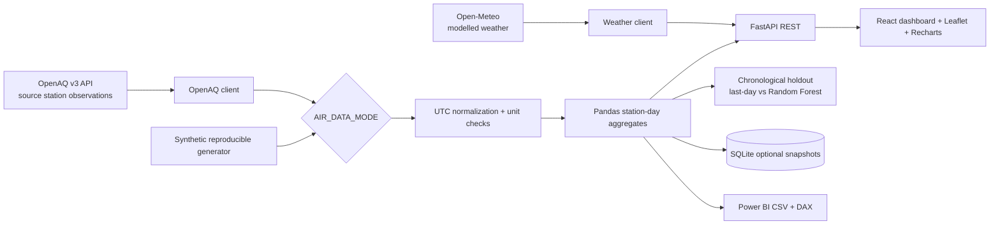

# Architecture and data provenance

## Measurement contract

- **Live:** OpenAQ station daily mean PM2.5 values. Metadata, provider and source dates vary. Only `µg/m³` readings are accepted; other units are not converted silently.
- **Demo:** deterministic, synthetic PM2.5 observations at fictitious stations, always labeled on screen.
- **Weather:** Open-Meteo grid/forecast fields; not equivalent to a measurement at an OpenAQ station. Demo includes separately labeled fabricated weather.
- **Forecast:** API returns an untrained previous-day persistence baseline. `train.py` separately evaluates a Random Forest against baseline on synthetic history; it does **not** switch the live API to a trained model.
- **Heat:** apparent-temperature thresholds are project-specific **illustrative bands**, not official meteorological advisories and not individual health-risk classification.
- **Data coverage:** `observed station-days / (discovered stations × 120 days)`; this is not geographical coverage or monitor certification.

## Security posture

- API keys only on backend; `.env` is gitignored. Frontend receives no API secrets.
- CORS restricted via `CORS_ORIGINS`. Read-only endpoints; no personal accounts or user data.
- No unsafe deserialization on untrusted model artifacts: only load locally created joblib files offline.
- Production deployment still requires proxy/TLS, rate limiting, monitoring, dependency updates, backup plans and authorized licenses.
